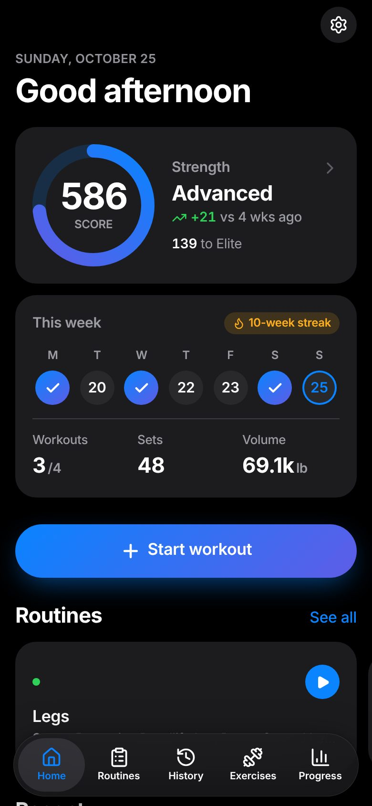
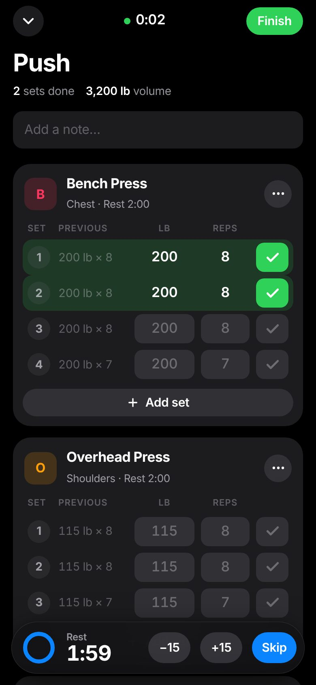
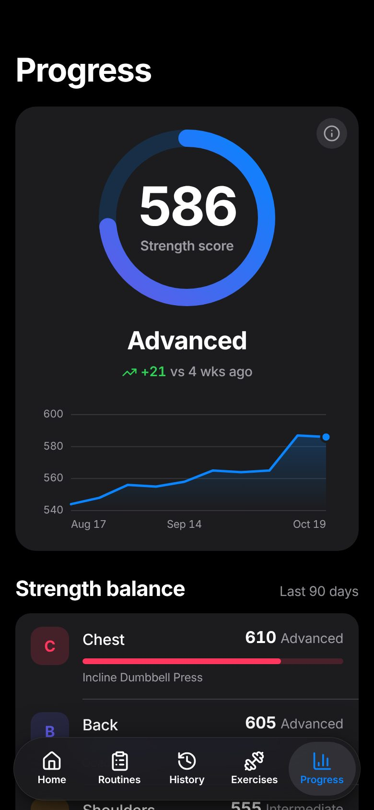
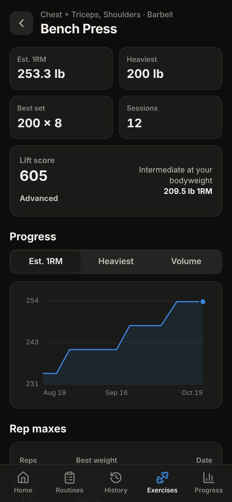

# Forge — workout tracker

A mobile-first workout tracker inspired by [Caliber](https://caliberstrong.com/): log your lifts, follow routines, and watch your strength score climb. Everything lives in one place, works offline, and installs to your phone's home screen like a native app.

<p>
  
  
  
  
</p>

## Features

**Workout logging**
- Start an empty workout or one from a routine; a live timer runs in the header
- Log weight × reps, bodyweight reps (+ added weight), timed holds, or distance + time for cardio
- **Previous** column shows what you did last time; empty fields auto-fill from it when you tick ✓
- Warm-up, drop and failure sets (tap the set number)
- Rest timer starts automatically after each set, with ±15s / skip, a beep and a vibration
- 🏆 PR badges as you beat your best estimated 1RM, weight, reps, time or distance
- Per-exercise notes and rest times, replace / reorder / remove exercises
- Minimise a workout and keep browsing — a bar at the bottom brings you back

**Smart training**
- **Smart targets**: a suggested weight × reps for every exercise, based on your last session (add weight once you hit your reps on every set, repeat otherwise, deload after three stalled sessions)
- One-tap **warm-up sets** that ramp up to your working weight
- **Plate calculator** showing exactly which plates go on each side of the bar

**Strength score** (Caliber-style)
- One number for overall strength, from **Beginner** to **Elite**
- Compares your estimated 1RM on ~45 scored lifts with standard strength levels for your bodyweight and sex
- Breakdown by muscle group (chest, back, shoulders, arms, legs) so you can spot weak points
- 12-week score history

**Routines & programs**
- Build reusable routines with target sets, reps, weight and rest
- One-tap import of ready-made programs: Full Body, Upper/Lower, Push/Pull/Legs, Strength 5×5
- Save any finished workout as a routine, or repeat it

**History & progress**
- Workout history as a list or a calendar, with PRs per workout; edit or backfill past workouts
- Per-exercise charts (est. 1RM, heaviest, volume), rep-max table and full set history
- Weekly volume / workouts / sets charts
- **Muscle map**: front/back body diagram of your weekly sets per muscle, against the 10–20 sets/week growth range
- **Recovery**: which muscle groups are fresh, recovering or just trained, on Home and Progress
- **Exercise guides**: muscles worked, how-to steps and form cues for every built-in exercise
- Bodyweight log with trend chart

**Your data**
- ~90 built-in exercises, plus your own custom ones
- lb or kg (switch any time — everything converts)
- Stored on your device (IndexedDB). Export / restore a JSON backup, or export every set as CSV for spreadsheets
- **Import history** from other apps' CSV exports: Strong and Hevy are recognised automatically, and any other spreadsheet can be mapped column by column, with exercise names matched to the library
- Optional **cloud sync** across devices via a free Supabase project (see [docs/sync-setup.md](docs/sync-setup.md))
- iOS-inspired design with light and dark themes: large titles, glass tab bar, activity-ring strength score and colour-coded muscle groups

## Using it on your phone

The app is a static site, so any static host works. The included GitHub Actions workflow publishes it to GitHub Pages:

1. In the repo on GitHub, open **Settings → Pages** and set **Source** to **GitHub Actions**.
2. Merge to `main` (or run the **Deploy to GitHub Pages** workflow manually from the Actions tab).
3. Open `https://<your-username>.github.io/Fitness-App/` on your phone:
   - **iPhone (Safari):** Share → **Add to Home Screen**
   - **Android (Chrome):** ⋮ menu → **Install app**

It then launches full-screen and works offline. Your data stays on that device, so use **Settings → Export backup** now and then (and to move to a new phone).

## Development

Requires Node 22.12+.

```bash
npm install
npm run dev        # http://localhost:5173
npm test           # unit tests (Vitest)
npm run typecheck
npm run build      # production build in dist/
npm run preview    # serve the production build
```

Stack: React 19, TypeScript, Vite, Zustand (persisted to IndexedDB), React Router, `vite-plugin-pwa`, Lucide icons. Charts are hand-rolled SVG. Text uses the system font (SF Pro on Apple devices, Inter elsewhere); the design tokens live at the top of `src/styles.css`.

```
src/
  data/        exercise library and ready-made programs
  lib/         pure logic: 1RM & PRs (calc), strength score, stats, units, backup
  store/       app state + IndexedDB persistence
  components/  workout editor, exercise picker, charts, sheets
  pages/       one file per screen
  test/        unit tests for the logic and store
```

### How the strength score works

For every working set of ≤12 reps in the last 90 days, the app estimates a one-rep max (Epley: `weight × (1 + reps / 30)`; bodyweight lifts include your bodyweight) and divides it by that lift's *intermediate* standard for your bodyweight. Matching the standard scores **500**. Each muscle group takes its best lift, and the overall score averages the groups you've trained. The standards are in `src/data/exercises.ts` (`standard`, as a multiple of bodyweight) and the scoring in `src/lib/strength.ts`. They are approximations based on common strength standards, not Caliber's own formula.
